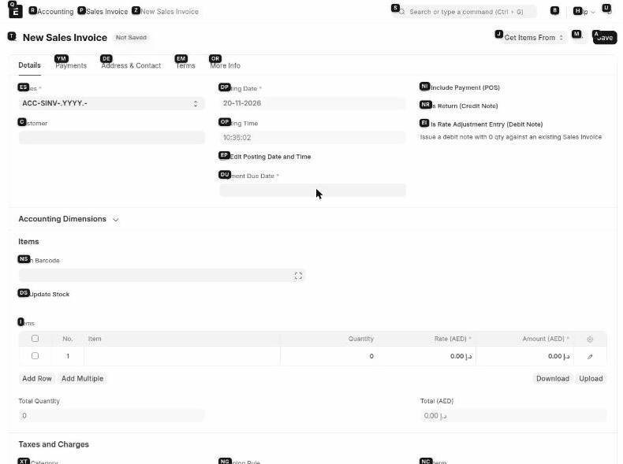

### Keytips

Tap Alt and type: fixed keyboard keys for every button, field and page in Frappe Desk. Like
Excel's key tips, with keys that stay put so people work without looking, the way they did in
Tally.



### How it works

Tap Alt (on its own, like Excel) and every clickable thing on screen gets a small badge. Type the
letters to click it; a field gets focus. Esc, another Alt tap, a click or a scroll puts them away.
Alt held with another key (Alt+Tab, Desk's own Alt shortcuts) never shows them. Off on touch
screens.

Keys stay put, so people learn them without looking:

| Where | Keys |
|---|---|
| Every page | S search, A primary button (Add / Save), B notifications, H help, U user menu, V view switcher, R refresh, M ⋯ menu, P print |
| Workspaces in the sidebar | 1–9, then 01–09, 00, in order |
| Forms | each field and tab, from its label: C Customer, I Items, DP Posting Date |
| Lists | filters, status tabs, Filter and Sort |
| Reports | the report's filters and each column filter |
| Workspace pages | shortcut tiles and card links |

- A form's key works for a field that is off screen too: it opens the tab and scrolls to it.
- A table's key lands on its first empty row, or adds one on a draft.
- Alt then Down goes into the rows of a list or report: arrows move, Enter opens, Esc leaves.
  Rows get no badges, since they change all the time.

Keys are shared by everyone on the site. The first time anyone opens a form, list, report or
workspace its items get keys (first letter of the label where free) and they are saved in
**Keytip Map**, one record per page (`Sales Invoice`, `list:Sales Invoice`,
`report:Sales Register`, `workspace:Billing`). A new item gets the next free key and nothing
else moves. A System Manager can change any key there; it refuses clashes (C and CA cannot
both exist). Delete a row to have it assigned again.

Turn it off for one browser: `localStorage.setItem("keytips-off", "1")`.

Works on plain Desk and with techountant_theme (its rail gets the workspace numbers).

### Installation

You can install this app using the [bench](https://github.com/frappe/bench) CLI:

```bash
cd $PATH_TO_YOUR_BENCH
bench get-app https://github.com/techountant/keytips
bench install-app keytips
```

### Contributing

This app uses `pre-commit` for code formatting and linting. Please [install pre-commit](https://pre-commit.com/#installation) and enable it for this repository:

```bash
cd apps/keytips
pre-commit install
```

Pre-commit is configured to use the following tools for checking and formatting your code:

- ruff
- eslint
- prettier
- pyupgrade

### License

mit
